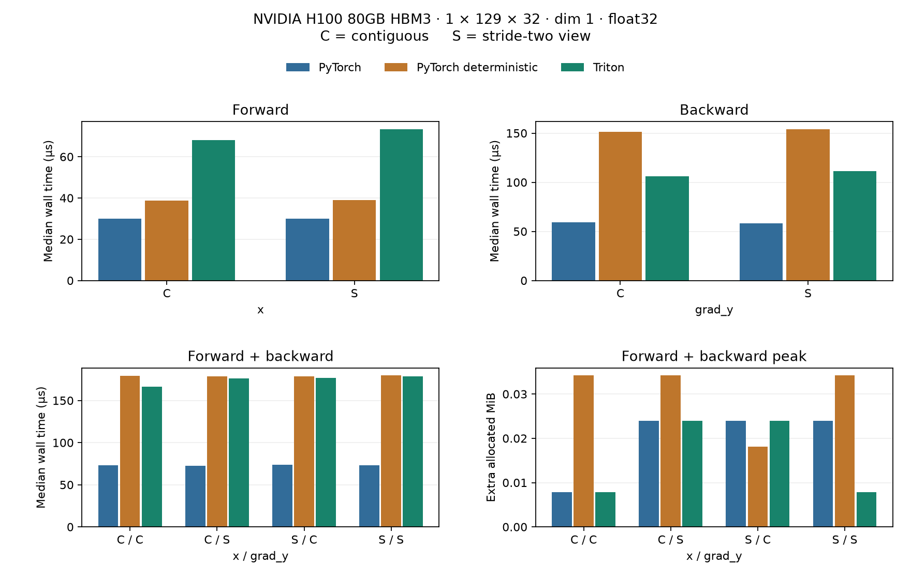
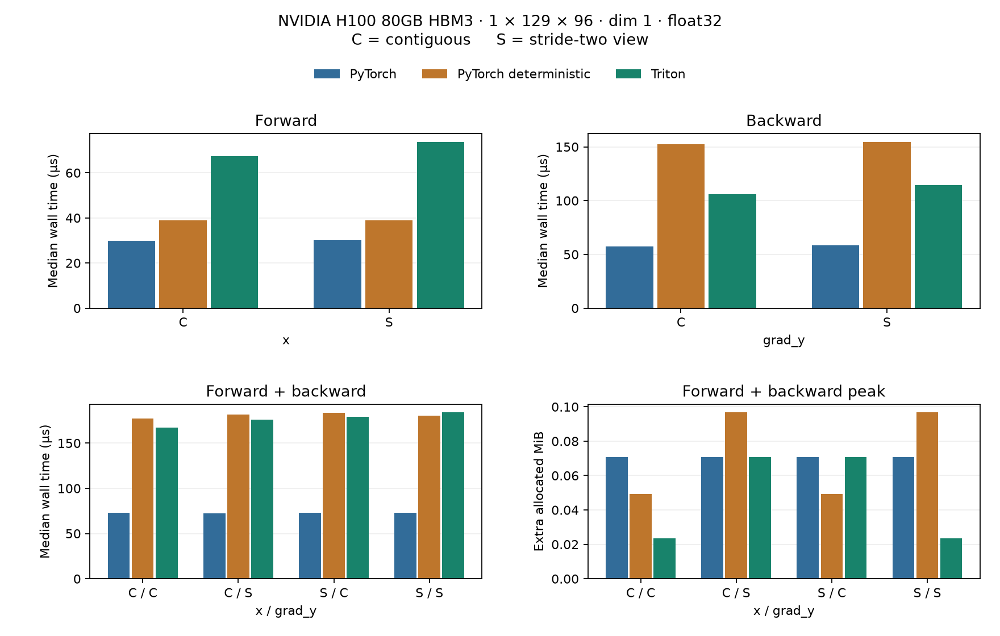
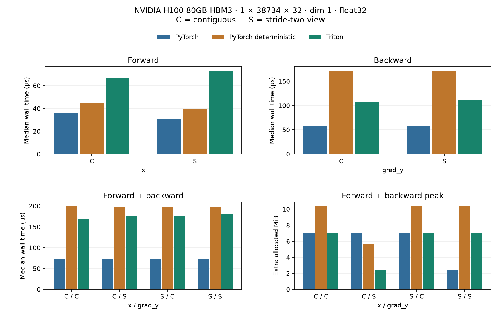
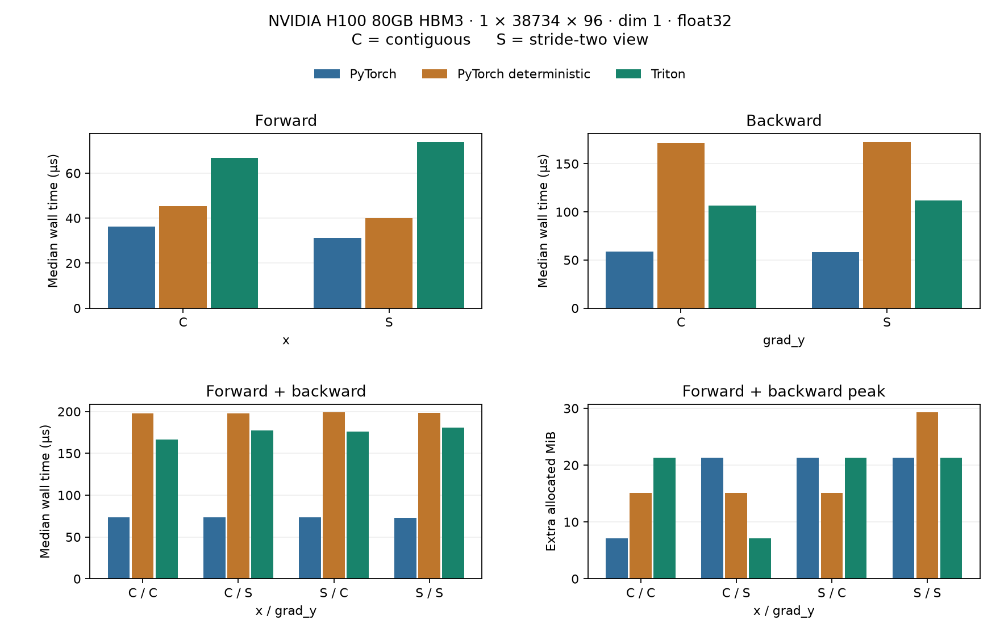

# Index selection by tensor layout

C means contiguous. S is a view with storage stride two on its innermost axis. The index vector is contiguous throughout.

Forward varies x. The isolated backward uses a retained graph built with contiguous x and varies grad_y. Combined measurements vary both layouts.

Timing cells give median synchronized wall / device-event time in µs in eager mode. Peak cells give extra allocated MiB for a combined call above the live inputs and graph.

Measured on NVIDIA H100 80GB HBM3 with PyTorch 2.8.0+cu128 and Triton 3.4.0. 10 warmups and 100 samples per timing.

## NVIDIA H100 80GB HBM3 · 1 × 129 × 32 · dim 1 · float32

| Phase | x | grad_y | PyTorch | PyTorch deterministic | Triton |
| --- | --- | --- | ---: | ---: | ---: |
| Forward | C | — | 30.052 / 17.568 | 38.864 / 26.400 | 68.056 / 55.056 |
| Forward | S | — | 30.075 / 17.680 | 38.909 / 26.384 | 73.360 / 60.304 |
| Backward | — | C | 59.049 / 46.288 | 151.137 / 138.240 | 106.265 / 93.008 |
| Backward | — | S | 58.247 / 45.616 | 154.049 / 140.832 | 111.508 / 97.856 |
| Forward + backward | C | C | 72.961 / 60.208 | 179.447 / 165.872 | 166.698 / 152.848 |
| Forward + backward | C | S | 72.411 / 59.648 | 178.446 / 165.424 | 176.234 / 162.112 |
| Forward + backward | S | C | 73.584 / 60.672 | 178.388 / 165.136 | 176.989 / 162.864 |
| Forward + backward | S | S | 73.070 / 60.240 | 179.659 / 166.320 | 178.927 / 164.768 |
| Forward + backward peak | C | C | 0.008 | 0.034 | 0.008 |
| Forward + backward peak | C | S | 0.024 | 0.034 | 0.024 |
| Forward + backward peak | S | C | 0.024 | 0.018 | 0.024 |
| Forward + backward peak | S | S | 0.024 | 0.034 | 0.008 |

## NVIDIA H100 80GB HBM3 · 1 × 129 × 96 · dim 1 · float32

| Phase | x | grad_y | PyTorch | PyTorch deterministic | Triton |
| --- | --- | --- | ---: | ---: | ---: |
| Forward | C | — | 29.930 / 17.568 | 38.858 / 26.304 | 67.289 / 54.272 |
| Forward | S | — | 30.066 / 17.632 | 39.005 / 26.528 | 73.707 / 60.608 |
| Backward | — | C | 57.369 / 44.736 | 152.414 / 139.456 | 105.878 / 92.480 |
| Backward | — | S | 58.230 / 45.712 | 154.613 / 141.584 | 114.364 / 100.656 |
| Forward + backward | C | C | 72.875 / 60.176 | 177.340 / 164.160 | 167.044 / 153.024 |
| Forward + backward | C | S | 72.441 / 59.712 | 181.583 / 168.272 | 175.703 / 161.744 |
| Forward + backward | S | C | 73.268 / 60.768 | 183.467 / 170.560 | 179.124 / 164.848 |
| Forward + backward | S | S | 72.998 / 60.416 | 180.332 / 167.040 | 183.911 / 169.392 |
| Forward + backward peak | C | C | 0.071 | 0.049 | 0.023 |
| Forward + backward peak | C | S | 0.071 | 0.097 | 0.071 |
| Forward + backward peak | S | C | 0.071 | 0.049 | 0.071 |
| Forward + backward peak | S | S | 0.071 | 0.097 | 0.023 |

## NVIDIA H100 80GB HBM3 · 1 × 38734 × 32 · dim 1 · float32

| Phase | x | grad_y | PyTorch | PyTorch deterministic | Triton |
| --- | --- | --- | ---: | ---: | ---: |
| Forward | C | — | 36.080 / 23.648 | 45.032 / 32.544 | 66.938 / 53.728 |
| Forward | S | — | 30.480 / 18.000 | 39.498 / 26.960 | 73.003 / 59.904 |
| Backward | — | C | 58.145 / 45.648 | 171.094 / 158.192 | 106.781 / 93.424 |
| Backward | — | S | 58.034 / 45.168 | 171.400 / 158.032 | 112.285 / 98.704 |
| Forward + backward | C | C | 72.340 / 59.680 | 199.384 / 186.240 | 167.470 / 153.680 |
| Forward + backward | C | S | 72.889 / 60.192 | 197.119 / 183.920 | 176.045 / 162.176 |
| Forward + backward | S | C | 72.688 / 59.936 | 197.783 / 184.464 | 174.840 / 160.960 |
| Forward + backward | S | S | 73.609 / 60.672 | 198.318 / 185.024 | 180.118 / 165.760 |
| Forward + backward peak | C | C | 7.093 | 10.354 | 7.093 |
| Forward + backward peak | C | S | 7.093 | 5.625 | 2.364 |
| Forward + backward peak | S | C | 7.093 | 10.354 | 7.093 |
| Forward + backward peak | S | S | 2.364 | 10.354 | 7.093 |

## NVIDIA H100 80GB HBM3 · 1 × 38734 × 96 · dim 1 · float32

| Phase | x | grad_y | PyTorch | PyTorch deterministic | Triton |
| --- | --- | --- | ---: | ---: | ---: |
| Forward | C | — | 36.173 / 23.712 | 45.284 / 32.768 | 66.873 / 54.224 |
| Forward | S | — | 31.106 / 18.656 | 40.075 / 27.584 | 73.906 / 60.880 |
| Backward | — | C | 58.540 / 45.728 | 171.466 / 158.160 | 106.418 / 93.040 |
| Backward | — | S | 58.412 / 45.664 | 172.696 / 159.552 | 111.642 / 97.824 |
| Forward + backward | C | C | 73.394 / 60.672 | 197.570 / 184.352 | 166.450 / 152.416 |
| Forward + backward | C | S | 73.683 / 60.928 | 197.760 / 184.592 | 177.666 / 163.696 |
| Forward + backward | S | C | 73.486 / 60.864 | 198.909 / 185.712 | 175.938 / 161.904 |
| Forward + backward | S | S | 73.032 / 60.336 | 198.735 / 185.440 | 180.875 / 166.736 |
| Forward + backward peak | C | C | 7.093 | 15.083 | 21.278 |
| Forward + backward peak | C | S | 21.278 | 15.083 | 7.093 |
| Forward + backward peak | S | C | 21.278 | 15.083 | 21.278 |
| Forward + backward peak | S | S | 21.278 | 29.268 | 21.278 |

